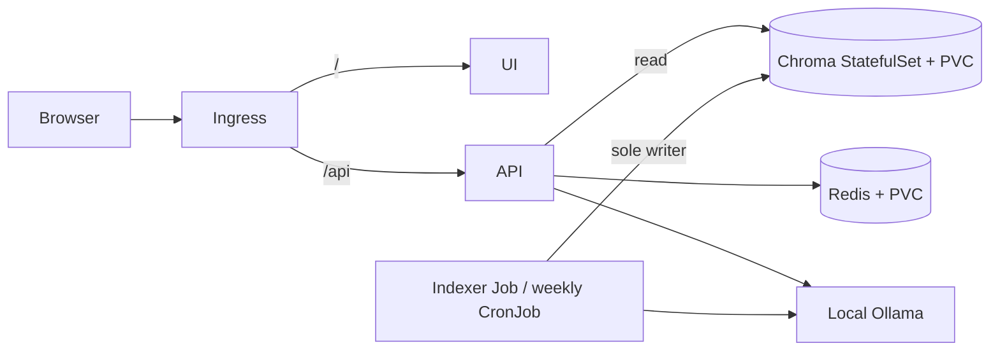

# RAHBAR

[](https://github.com/momnakhan24/rahbar/actions/workflows/ci.yml)

Grounded question answering over nine public FAST-NUCES documents. The indexer Job
extracts/OCRs, cleans, chunks and embeds documents, then atomically publishes Chroma.
Three API replicas only read that index. Answers cite retrieved policy excerpts;
questions without sufficient evidence receive a refusal. Raw university files are
ignored; their public URLs and SHA-256 checksums are in `corpus/MANIFEST.md`.



`dev` is the working Git branch. Separately, `k8s/overlays/dev` is a **stub plumbing
configuration**, `local` is the real Docker/Minikube configuration, and `prod` uses
published images and the real provider. CD deploys a disposable stub acceptance
cluster after the full real-retrieval fixture CI gate; it does not host the university
corpus as a public service. Real-corpus evaluation is performed on local Minikube.

## Requirements

Docker Desktop running Linux containers, Minikube, kubectl, Git, and Python 3.12+.
Allow 6Gi/six CPUs for the Minikube node plus additional host memory for Ollama.
On this Windows installation, Minikube is in `C:\Program Files\Kubernetes\Minikube`.
If `Get-Command minikube` cannot find it, add that directory for the current terminal:

```powershell
$env:Path += ';C:\Program Files\Kubernetes\Minikube'
minikube version
```

Run the following PowerShell commands from the repository root. Keep the `rahbar`
profile separate from other projects. Installation is required only once:

```powershell
python -m venv .venv
.venv\Scripts\python -m pip install -r api/requirements-dev.txt -r indexer/requirements-dev.txt
.venv\Scripts\python corpus/fetch.py
.venv\Scripts\python corpus/fetch.py --verify
```

The reviewed `corpus/sources.yaml` is already committed. Do not overwrite it with the
example. Downloaded files belong in ignored `corpus/raw`, not Git.

## Clean-clone real deployment on Windows / Docker

These steps target a **new** `rahbar` profile/namespace. For an existing deployment,
inspect its active index and Jobs first; do not launch concurrent indexing writers.

```powershell
minikube start -p rahbar --driver=docker --cni=calico --memory=6144 --cpus=6
minikube -p rahbar addons enable metrics-server
minikube -p rahbar addons enable ingress
```

The local overlay uses Docker network `rahbar`, Ollama address `192.168.49.11`.
Confirm `docker network inspect rahbar` shows the `192.168.49.0/24` subnet and that
`.11` is free before the first container creation. A different subnet requires changing
both `OLLAMA_URL` and the API/indexer egress CIDRs in your local overlay. For an existing
`rahbar-serving` container, reuse it instead of running another with the same name.

```powershell
docker volume create rahbar-models
docker run -d --name rahbar-serving --network rahbar --ip 192.168.49.11 `
  --cpus 4 --memory 4g -e OLLAMA_HOST=0.0.0.0 -e OLLAMA_MAX_LOADED_MODELS=2 `
  -v rahbar-models:/root/.ollama `
  ollama/ollama@sha256:ebaef4f4c5d93660e1f25f8ad085a112f51ccfb0e8458073e71793959dba91c9
docker exec rahbar-serving ollama pull nomic-embed-text
docker exec rahbar-serving ollama pull qwen2.5:3b
```

Build the exact checked-out source, load it into Minikube, and create an ignored overlay
that overrides all three image tags with that source SHA. The checked-in overlay records
the measured release; this generated overlay also works for a later checked-out revision.

```powershell
$tag = (git rev-parse HEAD).Trim()
foreach ($component in @('api','indexer','ui')) {
  docker build -t "rahbar-${component}:$tag" $component
  if ($LASTEXITCODE) { throw "Build failed: $component" }
  minikube -p rahbar image load "rahbar-${component}:$tag"
  if ($LASTEXITCODE) { throw "Image load failed: $component" }
}
New-Item -ItemType Directory -Force work/local | Out-Null
@"
apiVersion: kustomize.config.k8s.io/v1beta1
kind: Kustomization
resources:
  - ../../k8s/overlays/local
images:
  - name: rahbar-api
    newTag: $tag
  - name: rahbar-indexer
    newTag: $tag
  - name: rahbar-ui
    newTag: $tag
"@ | Set-Content work/local/kustomization.yaml
```

**Load corpus before applying the overlay**, because the overlay creates the indexing
Job immediately. The temporary loader is hardened, has resources and no service token.

```powershell
kubectl --context rahbar apply -f k8s/base/namespace.yaml
kubectl --context rahbar apply -f k8s/base/corpus-pvc.yaml
kubectl --context rahbar apply -f k8s/base/corpus-loader.example.yaml
kubectl --context rahbar -n rahbar wait --for=condition=Ready pod/corpus-loader --timeout=3m
kubectl --context rahbar cp corpus/raw/. rahbar/corpus-loader:/corpus
if ($LASTEXITCODE) { throw 'Corpus copy failed; do not start indexing' }
kubectl --context rahbar -n rahbar delete pod corpus-loader --wait=true
kubectl --context rahbar apply -k work/local
kubectl --context rahbar -n rahbar rollout status statefulset/chroma --timeout=5m
kubectl --context rahbar -n rahbar rollout status deployment/redis --timeout=3m
kubectl --context rahbar -n rahbar wait --for=condition=complete job/indexer --timeout=2h
kubectl --context rahbar -n rahbar rollout status deployment/api --timeout=5m
kubectl --context rahbar -n rahbar rollout status deployment/ui --timeout=3m
```

The recorded full OCR/embedding run took about 29 minutes; cold downloads and slower
CPUs can take longer. If it fails, inspect `kubectl describe pod`, Job logs and events;
do not start a second writer while the first is running. The weekly CronJob uses the
same real pipeline. Changing the embedding pin requires re-indexing; API readiness
rejects an index/model mismatch. Hosted generation is optional and requires a local
Kubernetes Secret; this Ollama configuration requires no LLM key.

Start this port-forward and leave its terminal running:

```powershell
kubectl --context rahbar -n ingress-nginx port-forward service/ingress-nginx-controller 18080:80 --address 127.0.0.1
```

Open **http://localhost:18080**. The Ingress accepts localhost and rahbar.local;
no hosts-file change is needed. Do not open `ui/index.html` as a file. In another terminal:

```powershell
Invoke-RestMethod http://localhost:18080/api/ask -Method Post -ContentType application/json `
  -Body '{"question":"What minimum CGPA avoids academic warning?"}'
```

`/healthz`, `/readyz` and `/metrics` are API routes. To inspect them directly, run a
second port-forward: `kubectl --context rahbar -n rahbar port-forward service/api 18081:8000`.
The Ingress `/` route goes to the UI; `/api` goes to the API.

## Tests and evaluation

```powershell
Push-Location api
..\.venv\Scripts\pytest --cov=app --cov-fail-under=60 -q
..\.venv\Scripts\mypy app
Pop-Location
Push-Location indexer
..\.venv\Scripts\pytest -q
..\.venv\Scripts\mypy pipeline
Pop-Location
.venv\Scripts\ruff check api indexer eval corpus
.venv\Scripts\python -m pytest eval -q
.venv\Scripts\python eval/run_eval.py --api http://localhost:18080 --timeout 480 --out eval/results.json
.venv\Scripts\python scripts/check_submission.py
```

The unchanged real golden set has **19 questions**. `eval/results.json` and
`eval/baseline.json` hold real-corpus measurements; `docs/evidence/final-responses.json`
and the generation review preserve per-answer evidence. Update a baseline only after
review, using `--update-baseline`, then rerun without that flag. Fixture evaluation uses
its own golden set/baseline; fixture scores must never replace real-corpus measurements.
Chunking and cache-threshold measurements are explained in `docs/PIPELINE.md`.

## CI, CD and submission

CI performs lint/type checks, tests with coverage, strict manifest validation, image
builds/scans, a kind rollout, and actual fixture indexing/retrieval plus evaluation.
CD reuses that full CI suite before publishing anything, then builds/scans/pushes
`aimwnoaim/rahbar-{api,indexer,ui}:<github.sha>`. Only successful publication unlocks
an ephemeral acceptance deployment and JSON-validated smoke test through Ingress.
Runs upload evaluation, image-digest and acceptance artifacts. See `docs/OWNER-STEPS.md`
for exact repository settings and final submission steps. Credentials belong only in
GitHub Secrets; never paste them into code, Git history, PR descriptions or screenshots.

`main` requires a PR, up-to-date `quality` and `cluster-smoke` checks, and one genuine
review approval. Work and pushes use `dev`; no direct push to main is needed. Final
CI and CD status must be checked on the actual submitted commit. An earlier green run
cannot verify later changes, and a local acceptance run cannot establish hosted CD success.

See `docs/WORKLOG.md` for the chronological audit trail, `docs/SUBMISSION-CHECKLIST.md`
for remaining requirements, and `docs/AI-USAGE.md` for the extent of AI assistance.


| Method | API path | Purpose |
| --- | --- | --- |
| GET | `/healthz` | Process liveness without downstream dependencies |
| GET | `/readyz` | Index/model/dependency readiness |
| GET | `/metrics` | Prometheus metrics |
| POST | `/api/ask` | Validated question, cited answer or refusal |

The clean-clone `kubectl apply` order above creates storage and loads the corpus
before the real indexing Job. All namespace operations explicitly target rahbar.
